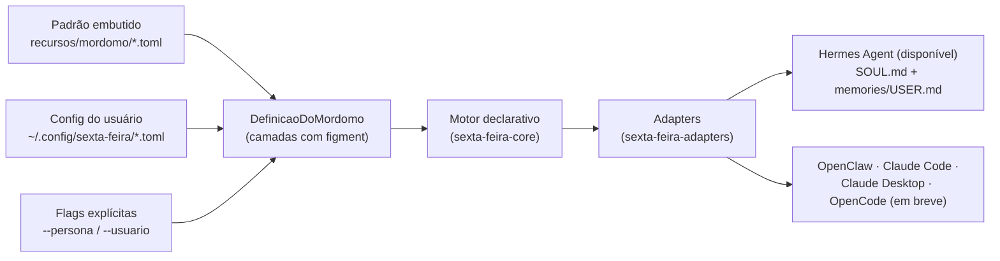

<div align="center">

# Sexta-feira

**Um único pacote declarativo para transformar seu agente de IA em um mordomo virtual pessoal — sem reconfigurar tudo do zero a cada máquina ou VPS.**

[](https://github.com/ygorsimoes/sexta-feira/actions/workflows/ci.yml)
[](https://github.com/ygorsimoes/sexta-feira/actions/workflows/release.yml)

[](LICENSE)

[Início rápido](#-início-rápido) · [Personalização](#-personalização-sem-recompilar) · [Referência da CLI](#-referência-da-cli) · [Situação](#-situação-do-projeto) · [Documentação](#-documentação)

</div>

---

## ✨ Por que existe

Configurar identidade, regras de conduta, forma de tratamento e preferências diretamente dentro de cada agente torna difícil migrar entre máquinas, VPS e ferramentas diferentes.

A **Sexta-feira** mantém quem o seu mordomo é (estilo **J.A.R.V.I.S.**, em `pt-BR`) em uma fonte única declarativa e traduz esse setup de forma **idempotente** e **segura** para o harness escolhido — preservando memórias existentes e exigindo confirmação explícita antes de sobrescrever alterações manuais.



---

## 🚀 Início rápido

### Instalar com seu próprio agente (recomendado)

Peça diretamente ao agente que você já usa (Hermes, Claude Code, OpenCode, OpenClaw etc.) para ler [a skill de instalação](recursos/skills/instalar-sexta-feira/SKILL.md) e configurar tudo para você — usando a CLI `sexta-feira` quando há adapter oficial e fazendo tradução assistida de `recursos/mordomo/*.toml` nos demais harnesses:

```text
Leia https://raw.githubusercontent.com/ygorsimoes/sexta-feira/main/recursos/skills/instalar-sexta-feira/SKILL.md e instale a Sexta-feira neste ambiente seguindo as instruções.
```

---

### Instalação manual pela CLI

#### 1. Instale ou compile o binário

> **Binário pronto (Releases):** baixe o pacote da sua plataforma na página de [Releases](https://github.com/ygorsimoes/sexta-feira/releases) (`x86_64-unknown-linux-musl`, `aarch64-unknown-linux-musl` ou `aarch64-apple-darwin`), confira `SHA256SUMS.txt` e coloque `sexta-feira` no seu `PATH`.

> **Pelo código-fonte:** a versão do Rust está fixada em [rust-toolchain.toml](rust-toolchain.toml) e o `rustup` a instala automaticamente:
>
> ```bash
> cargo build --release --package sexta-feira-cli
> # binário gerado em ./target/release/sexta-feira
> ```

#### 2. Configure e aplique o setup

Se estiver rodando direto do repositório sem instalar, substitua `sexta-feira` por `cargo run -q -p sexta-feira-cli --`.

```bash
# 1. (Opcional) Inspecione ambiente, camadas de config e harnesses disponíveis
sexta-feira diagnostico

# 2. (Opcional) Configure tratamento e preferências de forma guiada
sexta-feira iniciar

# 3. Pré-visualize o plano e o diff sem alterar nada em disco
sexta-feira plano hermes

# 4. Aplique o perfil isolado `sexta-feira` no Hermes
sexta-feira aplicar hermes

# 5. Confirme que tudo está sincronizado (exit 0 quando OK)
sexta-feira verificar hermes
```

<details>
<summary>📂 O que muda no seu Hermes após <code>sexta-feira aplicar hermes</code></summary>

A Sexta-feira **não altera** o perfil global padrão (`~/.hermes/SOUL.md`). Ela cria o perfil isolado `$HERMES_HOME/profiles/sexta-feira/` (ou `--destino <dir>` / `--perfil <nome>`):

- `SOUL.md` — gerenciado integralmente pela Sexta-feira, com checksum salvo em `.sexta-feira-estado.toml`. Se você editar o arquivo manualmente depois, um próximo `aplicar` acusa conflito e só sobrescreve com `--forcar` (gerando backup `.bak`).
- `memories/USER.md` — gerenciado por bloco delimitado (`<!-- sexta-feira:inicio -->` ... `<!-- sexta-feira:fim -->`), preservando todas as memórias aprendidas pelo Hermes fora do bloco.

</details>

---

## 🎨 Personalização sem recompilar

O binário embute [recursos/mordomo/persona.toml](recursos/mordomo/persona.toml) e [recursos/mordomo/usuario.toml](recursos/mordomo/usuario.toml), mas você pode sobrescrever apenas os campos que quiser sem tocar no código:

1. **Camada global do usuário (automática):** crie `~/.config/sexta-feira/usuario.toml` (ou `persona.toml`, respeitando `$XDG_CONFIG_HOME`):

   ```toml
   # ~/.config/sexta-feira/usuario.toml
   tratamento = "comandante"
   preferencias = [
     "Respostas diretas ao ponto, com exemplos executáveis",
     "Destacar riscos e suposições antes de comandos destrutivos",
   ]
   ```

2. **Camada por execução (explícita):** passe `--persona <arquivo.toml>` e/ou `--usuario <arquivo.toml>` para `diagnostico`, `plano`, `aplicar` ou `verificar`.

Campos omitidos continuam herdando o padrão embutido, e chaves desconhecidas são rejeitadas na leitura para evitar erros silenciosos de digitação.

---

## 🛠️ Referência da CLI

| Comando / Opção | O que faz |
|---|---|
| `sexta-feira iniciar` | Guia a criação/atualização segura de `usuario.toml` (interativo ou `--nao-interativo`, `--tratamento`, `--preferencia`, `--sobrescrever`) |
| `sexta-feira diagnostico [harness]` | Inspeciona ambiente, camadas de configuração, harnesses e próximo passo recomendado |
| `sexta-feira harnesses` | Lista todos os harnesses previstos com status (`disponível` / `em breve`) |
| `sexta-feira plano <harness>` | Exibe ações (`CRIAR`, `ATUALIZAR`, `OK`, `REMOVER`, `CONFLITO`) e diff sem escrever no disco |
| `sexta-feira aplicar <harness>` | Aplica o plano; falha antes de gravar se houver conflito sem `--forcar` |
| `sexta-feira verificar <harness>` | Valida se todos os arquivos e permissões estão sincronizados |
| `--destino <dir>` | Define explicitamente o diretório base do harness (aceita `~/...` no Hermes e `--hermes-home` como alias) |
| `--perfil <nome>` | Escolhe o nome do perfil isolado no harness (padrão: `sexta-feira`) |
| `--persona <arq>` / `--usuario <arq>` | Sobrescreve persona ou perfil do usuário a partir de arquivos TOML |
| `--forcar` | Em `aplicar`, sobrescreve ou remove itens em conflito gerando backup `.bak` numerado |
| `-v` / `--verbose` (`-vv`, `-vvv`) | Emite contexto detalhado em `stderr` (camadas, destino, estratégias, métricas e `tracing`) sem sujar `--json` |
| `--json` | Flag global para saída estruturada em JSON (`stdout`) em qualquer subcomando |
| `SEXTA_FEIRA_LOG=debug` | Sobrescreve o nível do `tracing` em `stderr` (quando não definida, segue `-v`) |

---

## 📊 Situação do projeto

| Harness / Frente | Situação | Escopo |
|---|---|---|
| Núcleo declarativo (`sexta-feira-core`) | **Pronto** | Camadas (`figment`), `ArquivoIntegral`, `BlocoDelimitado`, `MesclagemEstruturada` (JSON/TOML), `+x` e poda de órfãos |
| **Hermes Agent** — Recorte 1 (Persona & Perfil) | **Disponível** | Perfil isolado (`SOUL.md` e `memories/USER.md`) |
| **Hermes Agent** — Recorte 2 (Ambiente) | *Em evolução* | `config.yaml`, skills (`SKILL.md`), scripts e rotinas |
| **OpenClaw**, **Claude Code**, **Claude Desktop**, **OpenCode** | *Em breve* | Adapters após consolidação dos incrementos do Hermes |

---

## 🗂️ Estrutura do repositório

```text
sexta-feira/
├── crates/
│   ├── sexta-feira-core/      # modelo agnóstico do mordomo e motor declarativo (sem conhecimento de harness)
│   ├── sexta-feira-adapters/  # catálogo de harnesses e tradução para cada destino
│   └── sexta-feira-cli/       # binário `sexta-feira`
├── recursos/
│   ├── mordomo/               # fonte única padrão de `persona.toml` e `usuario.toml`
│   └── skills/                # skills (SKILL.md), incluindo instalação guiada por agente
├── docs/                      # visão, arquitetura, stack, especificações e planos
├── docker/                    # Dockerfiles (CI e CLI), compose unificado e laboratório Hermes
└── .github/                   # workflows de CI, auditoria, release-please e CD
```

---

## 💻 Desenvolvimento

Antes de abrir uma pull request a partir de uma branch criada da `main`, rode localmente (ou dentro do container de CI padronizado via Docker):

```bash
just ci         # roda localmente lint (fmt, clippy, machete), doc, testes, cargo-deny e zizmor
just docker-ci  # roda os mesmos checks dentro do container Docker (sem instalar ferramentas no host)
just            # lista todos os grupos e receitas disponíveis
```

Sem `just`, execute os comandos equivalentes:

```bash
cargo fmt --all --check
cargo clippy --workspace --all-targets --locked -- -D warnings
RUSTDOCFLAGS="-D warnings" cargo doc --workspace --no-deps --locked
cargo test --workspace --locked
cargo test --doc --workspace --locked
```

Todo trabalho segue o fluxo descrito em [CONTRIBUTING.md](CONTRIBUTING.md) (`issue` → `branch` → `PR` com CI verde e squash merge).

---

## 📚 Documentação

- [Visão e arquitetura](docs/visao.md)
- [Ambiente Docker (CI, CLI e laboratório Hermes)](docs/ambiente-local-docker.md)
- [Stack de bibliotecas e ferramentas](docs/stack.md)
- [Como contribuir](CONTRIBUTING.md)
- [Guia para agentes](AGENTS.md)

---

## 📄 Licença

Distribuído sob a licença [MIT](LICENSE).
